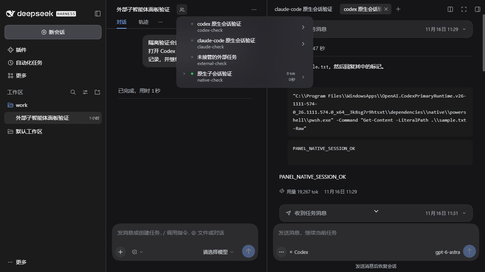

# 外部子智能体面板

在 DSH 的原生右侧标签栏查看 Codex、Claude Code 子智能体的实时执行过程，并在同一个原生会话中继续发送消息。

包名：`@dsh-plugin/dsh-subagent-panel`。



界面沿用 DSH 原生的主题颜色、内容字号、任务消息折叠行、工具展开行和一体式圆角输入框；菜单、Markdown 与滚动条复用宿主共享组件。[查看浅色主题](docs/preview-light.jpg)。

## 功能

| 功能 | 行为 |
| --- | --- |
| 会话入口 | 在原生「子智能体」列表的外部任务右侧补充打开箭头，保留原列表的名称、顺序和状态 |
| 右侧标签 | 每个任务使用独立的原生侧栏标签，可切换、停靠和关闭 |
| 完整过程 | 实时显示用户消息、中间文本、协议公开的思考摘要、工具参数、工具输出和最终回答 |
| 运行状态 | 显示连接中、执行中、完成、停止、失败及可恢复状态，记录每轮耗时和用量 |
| Codex 追加 | 运行时通过 `turn/steer` 追加；空闲时在同一 `threadId` 开始下一轮 |
| Claude Code 追加 | 持续保留 SDK 输入流；消息立即进入原生队列，由 Claude 在当前或后续轮次处理 |
| 停止与释放 | 停止当前轮次；释放进程保留记录，下次发送从原生会话历史恢复 |
| 记录保存 | 浏览器刷新或宿主重启后仍能查看；原生历史存在时可继续对话 |

首次委派结果仍由官方子智能体系统返回主智能体。侧栏中的后续对话由用户直接控制，不会重复向主智能体投递结果。Claude 的「停止当前轮次」保留已提交的排队消息；「释放进程」结束整个执行进程。

## 环境要求

- Node.js `>=24.9.0`。
- DSH `>=0.2.2-rc.3 <0.2.3`。
- `@dsh-plugin/dsh-loader` 2.0；本地验证版本为 `2.0.0-dev.43473963317`，需包含共享的 `Markdown` 和 `Scrollbar` 导出。
- 启用要使用的官方插件：`@deepseek-ai/dsh-subagent-codex` 和/或 `@deepseek-ai/dsh-subagent-claude-code`。
- 原生 Codex / Claude Code 已有可用登录或在官方插件的 `env` 中显式配置凭据。

插件接管上述官方提供方的执行入口，保留其名称、模型、权限模式、显式环境变量和进程释放宽限时间。禁用面板后恢复官方执行入口；启用前已启动的任务无法补采历史过程。

## 从本地源码安装

```powershell
cd C:\Projects\self\dsh-plugins\dsh-subagent-panel
pnpm install --frozen-lockfile
pnpm check

dsh plugin --profile web add "C:\Projects\self\dsh-plugins\dsh-subagent-panel"
```

缺少依赖时先安装所需插件：

```powershell
dsh plugin --profile web add @dsh-plugin/dsh-loader@2.0.0-dev.43473963317
dsh plugin --profile web add @deepseek-ai/dsh-subagent-codex@0.2.2-rc.3 @deepseek-ai/dsh-subagent-claude-code@0.2.2-rc.3
```

使用 DSH Launcher 时，应使用启动器当前 DSH 版本的命令行入口。安装后重启 DSH Web 并刷新浏览器；修改宿主端代码后同样需要重启。

本机启动器的安装命令为：

```powershell
$dshBin = 'C:\Users\Administrator\AppData\Roaming\in.dsh-plug.dsh-launcher\versions\0.2.2-rc.3\node_modules\@deepseek-ai\dsh\lib\bin.js'
node $dshBin plugin --profile web add 'C:\Projects\self\dsh-plugins\dsh-subagent-panel'
```

也可运行 `pnpm pack` 生成本地安装包，再用 `dsh plugin --profile web add "<安装包的绝对路径>"` 安装。当前项目尚未发布到 npm，不能直接用包名安装本插件。

## 使用

1. 在主会话中委派 `codex` 或 `claude-code` 子任务，名称随官方插件的 `providerName` 配置变化。
2. 点击标题栏原生的「N 个子智能体」，再点击对应外部任务右侧的箭头，在侧栏打开记录。子会话的目录菜单和展开后的下级目录也支持相同入口。
3. 展开工具卡片查看参数和输出。新输出自动滚到底部，向上滚动后暂停跟随。
4. 在底部输入消息，按 Enter 发送，Shift+Enter 换行。运行中也可以发送。
5. 点击输入框中的停止按钮中断当前轮次；左下角的圆形三点按钮打开「会话操作」菜单，可刷新记录或释放进程。关闭标签本身不停止任务。

## 数据与配置

在插件设置页调整「空闲进程保留时间」，默认 30 分钟。详细配置见 [docs/CONFIG.md](docs/CONFIG.md)。

展示记录保存于 `$DSH_HOME/data/dsh-subagent-panel/`（未设置时为 `~/.dsh/data/dsh-subagent-panel/`），按父会话分目录。记录包含任务输入、工具参数和输出，请按工作区数据管理。原生会话历史仍由 Codex / Claude Code 保存；不要删除其原生历史，否则只能查看面板记录，无法恢复执行。

面板不会持久化官方插件的 `env` 或凭据，也不会将其他 DSH 会话的凭据自动传给子进程。工具本身打印到输出中的内容会进入过程记录。

## 实现与验证

- 宿主通过 dsh-loader 注册鉴权 HTTP 接口，并通过 Cordis 公开注册表读取官方提供方的有效配置。
- Codex 使用固定版本 `@openai/codex@0.153.4` 的 app-server；Claude 使用 `@anthropic-ai/claude-agent-sdk@0.3.263` 的持续输入流。
- 子进程由 DSH `subprocess` 服务持有，插件卸载时等待退出并保存记录。
- 客户端使用官方槽位、右侧标签服务、宿主 React 和 dsh-loader 共享 UI；通过带 revision 的轮询获取增量状态，前台间隔约 750 毫秒。
- 目录入口按父会话与任务 ID 关联记录，在原生条目的箭头预留位置挂载；没有面板记录的外部任务保持原状。插件卸载时撤销槽位包装、箭头及键盘处理。
- `pnpm check` 执行类型检查、协议解析回归检查及构建。

真实进程的多轮对话、恢复和停止结果见 [本地验证记录](docs/verification.md)。

「思考过程」仅展示原生协议实际公开的文本或摘要；模型没有公开的内部思考不会出现在面板中。工具输出按原生事件到达情况显示，未提供输出增量的工具会在完成时显示结果。
